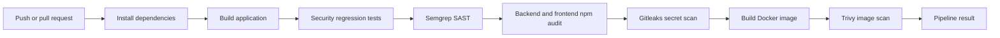
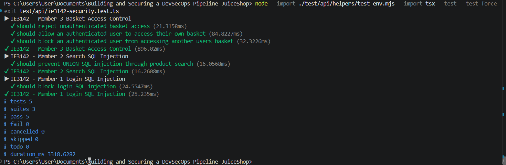

# Building and Securing a DevSecOps Pipeline for OWASP Juice Shop

A course project that adds a security-focused CI/CD workflow and deployment tooling around [OWASP Juice Shop](https://github.com/juice-shop/juice-shop), an intentionally vulnerable web application used for security education. The work combines automated security checks, regression tests, container hardening, secrets handling, and infrastructure-as-code examples.

> **Project scope:** this repository is a learning and assessment project. It contains CI configuration and deployment definitions; it does not include evidence of a production cloud deployment. The security scans are configured as pipeline checks, and their pass/fail thresholds are documented below.

## What I implemented

- **GitHub Actions DevSecOps workflow** for Node.js 24 that builds the server and runs security regression tests on pushes and pull requests.
- **Static application security testing (SAST)** using a custom Semgrep rule for potentially unsafe SQL interpolation.
- **Dependency checks** with `npm audit` for backend and frontend dependencies, using explicit severity thresholds as a baseline gate.
- **Secret scanning** with Gitleaks.
- **Container security**: build a Docker image and scan it with Trivy for high and critical vulnerabilities.
- **JWT key handling in CI**: signing keys are provisioned from GitHub Actions secrets at runtime rather than printed in logs.
- **Container hardening** in the root `Dockerfile`: a multi-stage build and a distroless runtime running as a non-root user.
- **Security regression tests** for login and search SQL injection attempts and basket access control.
- **Infrastructure-as-code examples** in `terraform/` for AWS ECS/Fargate-related resources, plus a Grafana dashboard definition.

## CI/CD security flow



The workflow is defined in [`.github/workflows/devsecops.yml`](.github/workflows/devsecops.yml). It runs on pushes to `main` and selected project branches, and on pull requests targeting `main`.

## Evidence and results

The saved Semgrep comparison reports show **one match before** and **zero matches after** for the project's custom SQL-interpolation rule. This is a narrow rule-specific comparison, not a claim that the application has no security vulnerabilities.

| Evidence | Result |
|---|---|
| Custom Semgrep rule (`semgrep-before.json` → `semgrep-after.json`) | 1 match → 0 matches |
| Security regression tests (saved terminal capture) | 5 passed, 0 failed |
| CI dependency audit | Severity thresholds are configured in the workflow; no scan summary is saved here |
| Trivy image scan | Fails the workflow on detected high or critical findings; no scan summary is saved here |



The five regression checks cover unauthenticated basket access, access to a user's own basket, blocking access to another user's basket, a search SQL injection attempt, and a login SQL injection attempt. The test definitions are in `test/api/ie3142-security.test.ts`.

## Technology

**GitHub Actions · Node.js 24 · TypeScript · Docker · Semgrep · npm audit · Gitleaks · Trivy · Terraform · AWS ECS/Fargate · Grafana**

## Run the application locally

Prerequisites: Node.js 24 and npm.

```bash
npm install
npm start
```

Then open [http://localhost:3000](http://localhost:3000). The project also includes a root `Dockerfile` and `docker-compose.yml` for a container-based run. This application is intentionally vulnerable for training; run it locally in a controlled environment and do not expose it to the public internet.

## Configure CI secrets

The workflow expects these GitHub Actions repository secrets:

- `JWT_PRIVATE_KEY_PEM`
- `JWT_PUBLIC_KEY_PEM`

Add your own development/test keys in **Settings → Secrets and variables → Actions** before running the workflow. Never commit private signing keys or other credentials. The project `.gitignore` excludes key files and the `secrets/` folder; verify they are not staged before publishing.

The dependency audit thresholds are explicit baselines, not zero-vulnerability guarantees: backend checks fail above 16 high or 7 critical findings; frontend checks fail above 4 high or any critical findings. Review and adjust these thresholds deliberately as dependencies change.

## Repository map

```text
.github/workflows/devsecops.yml   Custom CI security workflow
.semgrep/                         Custom Semgrep rule
Dockerfile                        Multi-stage, non-root runtime image
docker-compose.yml                Local container configuration
test/api/ie3142-security.test.ts  Security regression tests
terraform/                        AWS infrastructure definitions
monitoring/                        Grafana dashboard JSON
semgrep-before.json                Before-scan evidence
semgrep-after.json                 After-scan evidence
screenshots/                       Project screenshots
```

The repository also contains the upstream OWASP Juice Shop application and its own challenge material. In particular, the upstream `infrastructure/` directory is intentionally insecure and is documented as challenge content; it is not the hardened deployment configuration for this project.

## Attribution

The base application is [OWASP Juice Shop](https://github.com/juice-shop/juice-shop), an OWASP education project distributed under the MIT License. This repository is a course project that builds DevSecOps and security-testing work around that upstream application. Preserve upstream attribution and license notices when redistributing it.
